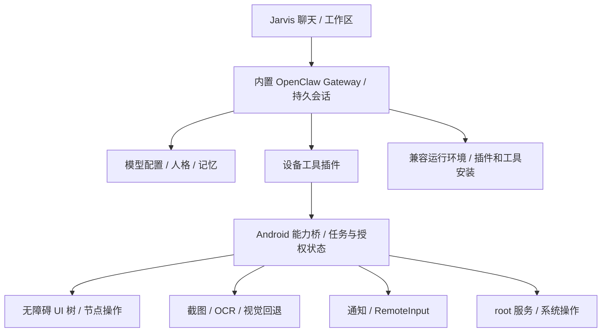

# Jarvis 移动端智能体方案可行性复核

复核日期：2026-10-26。源码基线：`D:\Jarvis`，HEAD `78479d6`。

审阅对象：`C:\Users\lenovo\AppData\Roaming\VClaw\.openclaw\workspace\outputs\2026-10\Jarvis-移动端智能体-开源方案说明文档.md`。

本次完成了本地源码、内置 ZIP/ELF 静态检查，以及关键上游仓库 README、源码、许可证和发布记录核对。没有在手机上启动 Gateway，也没有验证 QQ 收发；下述“已确认”仅指对应的静态证据。

## 结论

方案中的分层执行、能力探测、任务状态机和技能复用值得采用。但是，文档对现状有多处错误，对上游成熟度与工期的判断偏乐观，不能直接作为重构执行单。

“一个 Jarvis APK，自动准备运行环境，内置 OpenClaw，按实际授权操作手机”在技术上有可行路线。是否能稳定运行，必须通过目标真机验证。没有证据支持现在就删除内置运行时或把 Termux 改为必装依赖，这也不符合此前确定的产品目标。

当前最大的遗漏是：聊天界面尚未接入 OpenClaw 的代理执行链。即使 Gateway 启动、设备接口扩充完毕，保持现有聊天实现也无法自动使用那些工具。

## 已核实的现状与文档修正

| 文档判断 | 复核结果及影响 |
|---|---|
| 当前聊天已经围绕 OpenClaw 工作，只差设备桥完善 | 不成立。`MainActivity.kt:436` 调用 `callJarvisModel()`，后者直接请求用户配置的模型 API；`requestChatCompletion()` 只读取回复内容，没有工具调用循环，也没有 Gateway 会话调用。 |
| Jarvis 只有 4 个设备能力 | 不成立。`DeviceCapabilityBridge.kt:54` 和插件均列出 7 个能力，包括界面读取、OCR、通知读取。数量也不能直接与另一协议的 HTTP 端点数比较。 |
| IM 全部没有实现 | 表述过重。已有通知监听和最近通知读取；没有回复动作保存、发送接口、消息身份路由、去重和自动回复编排。 |
| 完全没有健康检查与能力列表 | 不准确。已有 `/health` 和 `/v1/capabilities`，但前者只确认桥接服务响应，后者只返回静态能力名称，没有实测权限和后端可用性。 |
| 人格只保存，未热加载 | 对现有聊天不成立。`callJarvisModel()` 每次发送都会使用当前 `mentorPrompt`、`worldBook`。真正缺的是与 Gateway 工作区配置同步、持久会话及记忆检索。 |
| 三个工具不能执行 | 确认。插件发送 `approved:false`，相机、点击、root 工具要求确认，没有实现可继续执行的审批流程。 |
| 审批可由调用方绕过 | 确认。服务端接受请求里的 `requiresApproval`、`approved`，执行层据此放行。需要持有桥接 token 才能调用，不能表述为任意本机进程无需鉴权即可利用。 |
| 直接使用 `su -c` 是问题根源，换 libsu 即可解决 | 原始 root 执行是能力选择；缺少权限策略才是实际问题。libsu 有助于管理持久 shell，但不会自动限制命令或防止越权。 |
| 手机 root 权限已经让普通/完全模式生效 | 源码不支持这个判断。`rootMode` 目前用于配置和界面，设备桥没有按它判定执行范围；启动失败时还会尝试让整个 Gateway 以 root 运行。 |
| 聊天上下文完整 | 不成立。界面消息在 `remember` 中，重建/重启会丢失；模型请求仅含系统提示和当前一条用户消息，之前消息没有发送。 |

证据入口：

- [MainActivity.kt](D:/Jarvis/app/src/main/java/com/jarvis/app/MainActivity.kt:540)
- [JarvisBridgeServer.kt](D:/Jarvis/app/src/main/java/com/jarvis/app/runtime/JarvisBridgeServer.kt:71)
- [DeviceCapabilityBridge.kt](D:/Jarvis/app/src/main/java/com/jarvis/app/runtime/DeviceCapabilityBridge.kt:32)
- [设备工具插件](D:/Jarvis/tools/jarvis-plugin/index.js:5)
- [通知监听](D:/Jarvis/app/src/main/java/com/jarvis/app/runtime/JarvisNotificationListenerService.kt:24)

## 内置运行时检查

`runtime.bundle.zip` 当前为 234,889,707 字节，44,336 个条目，解压后文件内容约 739 MB。它不是完全不含 Android 程序的 Windows 包，而是 Android Node/库与尚未完成平台适配的 JavaScript 依赖混合包。

已确认：

- `./node` 是 AArch64 ELF，解释器为 `/system/bin/linker64`，属于 Android/Bionic 路线。
- Node 的三个 `PT_LOAD` 段对齐均为 `0x4000`，即 16 KB。抽查的 `libc++_shared.so` 也是 16 KB 对齐。这不代表整个包、APK ZIP 对齐或全部动态库已经通过真机验证。
- Node 保留了 `/data/data/com.termux/files/usr/lib` 的 RPATH。Jarvis 用 `LD_LIBRARY_PATH` 指向自身目录；仍需检查其他二进制、子进程、脚本、证书、配置和硬编码路径。
- `koffi` 主包存在，没有 `@koromix` 平台二进制包；`@lydell/node-pty` 存在，没有其平台实现包。PTY 包声明的支持平台也不包括 Android，需要适配或明确禁用/回退策略。
- `.node` 文件除了 win32/darwin，还存在 Linux ARM64/x64 的 X11 插件。因此文档“唯一是 win32/darwin”不正确；Linux ARM64 X11 插件也不能据此视作 Android 可用实现。
- 包内 `bin/` 没有文件，尚不是具备 shell、下载器、包管理命令等基础设施的完整工具环境。

这些问题足以说明现有包不能作为已验证的运行时交付，但不足以静态断言“任何 Gateway 启动必然失败”。部分原生依赖按功能或平台延迟加载；需要启动日志及工具调用验证，判断是启动失败、特定功能不可用，还是走了回退。

当前启动逻辑只等待 800 毫秒并检查进程存活；初始化状态主要依据文件存在和可执行标记。两者都不能证明 Gateway 已就绪、模型配置有效或工具已经注册。

证据：[OpenClawProcessManager.kt](D:/Jarvis/app/src/main/java/com/jarvis/app/runtime/OpenClawProcessManager.kt:84)、[BootstrapController.kt](D:/Jarvis/app/src/main/java/com/jarvis/app/runtime/BootstrapController.kt:110)、[打包脚本](D:/Jarvis/tools/build-embedded-runtime.ps1)。

## 外部项目是否能复用

| 项目 | 实际可复用部分 | 必须注意的条件 |
|---|---|---|
| AidanPark/openclaw-android | 独立 APK、bootstrap、glibc/Node 启动、路径修补、工具安装与状态验证 | 独立 APK 确实存在；其 `targetSdk=28`，文档明确以此允许执行应用数据目录内的程序。Jarvis 是 35，无法只复制脚本。 |
| ClawMobile/ClawMobile | 任务/审批协议、能力探测、分层验证、演示生成技能思路 | 上游自述为 public preview；本地运行时和完整 OpenClaw Shell Runtime 是不同路径，后者仍使用 Termux。不能把本地 agent 直接等同于完整内嵌 OpenClaw。 |
| claw-use/claw-use-android | 语义 UI 树、ref 点击、输入、手势、截图、条件 flow | “只有设计稿”错误。当前仓库有 Java 实现，`BridgeService` 实际路由 `/screen`、`/snapshot`、`/act`；Releases 有 v1.8.0 APK。主分支 README 标注 v2.1.0，应固定版本核对，不能将主分支能力全部归入旧 APK。 |
| HKUDS/PhoneCLI | 已知界面的导航图、带检查点的操作回放、失败回退 | Android 使用 ADB，WebDriverAgent 是 iOS 路径。不能直接拿其 Python/桌面环境代码当作 APK 内置组件。 |

AidanPark 的 glibc 路线需要动态链接器及匹配的 glibc/附加库，不是只有一个 `ld.so` 文件。它使用的 Node 与 Jarvis 现有 Bionic Node 属于不同运行环境，不能混用原生插件。

上游 Android 模块许可证已核对：应用主体为 MIT；所带终端模块为 Apache-2.0。实际分发还需要保留这些组件和 bootstrap 中其他软件的许可证、NOTICE 及相应义务，不能把所有下载包统称为 MIT。

PhoneCLI README 支持减少重复导航推理的方向，但没有支持“Jarvis 的 90% 任务零模型调用”的证据。README 的一组结果是约减少 10% 云端调用；另一组速度对比硬件是 RTX 3090，不能作为手机端 3B/7B 性能依据。已知宏执行可以不调用模型，自然语言路由及动态任务仍可能调用模型。

参考源码和说明：

- [AidanPark Android 设计与许可证](https://github.com/AidanPark/openclaw-android/blob/main/android/README.md)
- [AidanPark targetSdk 配置](https://github.com/AidanPark/openclaw-android/blob/main/android/app/build.gradle.kts)
- [ClawMobile 当前限制](https://github.com/ClawMobile/ClawMobile/blob/main/docs/status-and-limitations.md)
- [ClawMobile 协议](https://github.com/ClawMobile/ClawMobile/blob/main/docs/runtime-protocol-v1.md)
- [claw-use 实际动作实现](https://github.com/claw-use/claw-use-android/blob/main/app/src/main/java/com/clawuse/android/handlers/ActHandler.java)
- [claw-use Releases](https://github.com/claw-use/claw-use-android/releases)
- [PhoneCLI 方法、结果与运行条件](https://github.com/HKUDS/PhoneCLI)

## 适合 Jarvis 的落地架构

保留单 APK 和自动配置目标，把上游已经实现的部件移植进 Jarvis，Termux 保留为可选择的恢复后端。

运行环境建议先做受控的真机比较：

1. 保留现有 Bionic Node 路线作为对照，确认 Node、Gateway、非 PTY shell 和必要原生模块分别能否运行。
2. 验证 AidanPark 独立 APK 的 bootstrap/glibc 路线能否迁移到 Jarvis 的包路径及执行策略。必须处理 targetSdk 35 的执行限制、root/SELinux 上下文、依赖库和子进程，不应通过改低 targetSdk 就宣称适配完成。
3. 依据两条路线的工具兼容性和真机日志选定主后端，避免同时混装两种 libc 的原生模块。

root 服务可以承接高权限系统操作；运行环境的实际 UID、SELinux 域和可执行位置需在原型阶段验证。普通模式若要由能力桥控制权限，就不能同时让模型绕过能力桥自由使用一个已具有全部 root 权限的执行通道。完全模式的授权范围、持续时间和取消行为需要在执行层生效。

“自由下载工具/插件”应实现为下载、安装、验证、启用、升级、回滚的完整流程。纯 JS 插件通常容易；原生插件、编译器和浏览器工具要匹配架构、libc、Node ABI 及 Android 环境。能下载文件不等于能运行任何 Linux 工具。

“root 后访问所有软硬件”也不能作绝对承诺。root 能显著扩展操作范围，但硬件密钥、TEE、驱动/HAL、SELinux、受保护画面及应用登录状态仍有各自约束。能力探测应该报告实际可用项及失败原因。

## QQ 与其他聊天软件

推荐“通知触发 + 可用时 RemoteInput 回复 + 无障碍节点操作 + OCR/视觉回退”的组合。QQ 只是这一通用消息流程的首个适配对象。

现有通知监听只保存包名、标题、文字、时间，尚未保留回复所需的 Action/PendingIntent。文档中的“带 MODE_PRIVATE 的 PendingIntent”是 API 错误：`MODE_PRIVATE` 是文件/偏好存储模式。RemoteInput 应使用目标应用提供的通知回复动作，通过 `RemoteInput.addResultsToIntent()` 填入结果再发送；动作是否存在、是否可修改、是否要求解锁取决于应用及系统配置，不能保证锁屏可发。

官方 Bot API 适用于对应平台的机器人能力，不能直接代替个人 QQ 账号访问任意好友会话。需要针对真实安装的 QQ 版本检查通知和界面。

指定联系人发命令、其余联系人按人格回复可以设计，但必须区分可验证的会话身份与昵称；当前代码尚无该路由。群聊、同名联系人、重复通知、自己发出的消息、多 Android 用户/工作资料空间都应纳入判断。自动发送开关可以提供，具体可靠性需要在目标 QQ 上测量。

## 建议以验收关卡替代“补齐 37 端点”

| 顺序 | 完成条件 |
|---|---|
| 1. 运行时验证 | 目标 ARM64 真机上 Node/Gateway 启动；真实健康检查通过；模型请求成功；重启可恢复；记录可诊断日志。 |
| 2. 最小代理闭环 | 聊天请求进入 Gateway，调用 `device.info` 等工具，得到手机实际结果，再由模型回复；模型配置和插件加载状态可验证。 |
| 3. 手机操作闭环 | 打开一个应用，读取界面，定位节点，输入中文，执行点击，并验证结果；权限失效有明确提示。无障碍为主，OCR/视觉作回退。 |
| 4. 消息场景 | QQ 指定会话定位、生成内容、按开关确认/发送、结果验证、重复触发抑制；先在明确的测试会话中验收。 |
| 5. 日常可用性 | 会话/工作区落盘，正确恢复上下文，通知事件进入任务队列，支持取消与超时；后台/锁屏/断网/进程被回收后恢复。 |
| 6. 扩展 | 插件安装及回滚、更多硬件能力、人格/世界书继承、演示技能；本地小模型按实际性能决定是否引入。 |

审批与 root 执行权限应在开放真实动作前落实，采用服务端持有的任务、授权范围和审批记录。能力探测可以先做，但它只能报告能力，不会自动补上缺失的执行链。

文档“6 天从 UI 原型到能用”缺少依据：没有计入运行时移植、Gateway 对话接入、模型配置同步、持久会话、中文输入和 QQ 适配、Android 前台服务/后台限制及真机回归。适合先给第 1、2 关设置短期验证目标，再以真实日志估算后续工期。

建议采用其架构原则，修正文档事实，先打通一个可观察、可复现的真实任务，再扩展能力覆盖。现有源码和资源无需因这次审阅立即删除。
